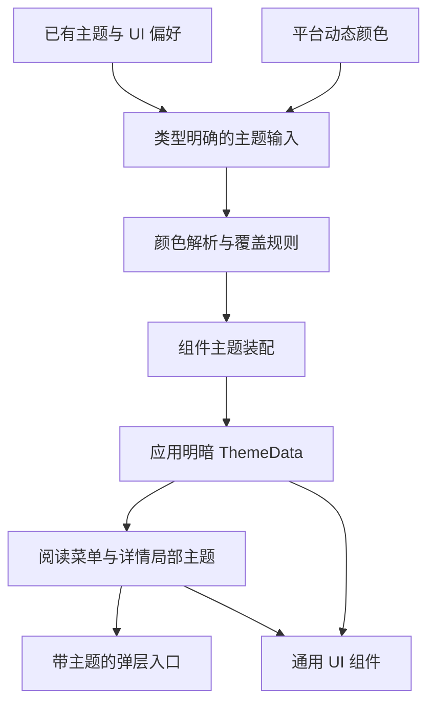

# 主题管理与 UI 架构优化建议

本方案依据 `feature/ui-reader-selection` 合并提交 `c68c52904` 调研；后续工作在
`build/worktrees/reader-overlay` 的 `feature/ui-reader-refinement` 进行。
后续实施按下述批次划分，批次 A、B 的接口说明见下文。任务状态只维护于
[Active 计划](REFACTORING_ACTIVE_PLAN.md)，既有视觉规则仍见 [设计系统](design_system.md)。

## 结论与边界

优先让主题计算、组件装配和局部主题接线具有明确入口，再收敛设置状态和外观页面。
保留 Riverpod、独立 material_ui/cupertino_ui、现有 MD3 色板及 Flutter/Rust 边界。
不同职责可以有多个 Provider；需要统一的是每个字段的归属和最终主题输出，
不必把所有外观、布局、阅读设置合成一个大型 Notifier。

Flutter 官方建议区分 UI、状态与数据职责，同时明确这些建议应按项目情况采用，
不要求更换现有状态管理方案。[官方架构建议](https://docs.flutter.dev/app-architecture/recommendations)

## 调研基线实现与发现（c68c52904）

| 位置 | 当前职责与证据 | 后续处理 |
|---|---|---|
| `lib/app.dart:316` | 合并主题模式、内置色板、自定义颜色、动态颜色、参数化配置；同时装配背景、护眼及全局宿主 | 提取主题解析，入口继续负责平台输入与应用装配 |
| `src/theme/app_theme.dart:28` | 组件主题已集中；卡片圆角仍隐式读取全局 uiSettingsListenable | 把圆角等输入显式传入，使相同输入产生相同 ThemeData |
| `src/providers/ui_settings/ui_settings_notifier.dart:265` | Riverpod 状态另同步到全局 ValueNotifier，七个源文件使用镜像或直接读取 `.value` | 按用途迁到可订阅的页面作用域和主题数据，减少全局镜像 |
| `src/screens/book_info_screen.dart:350` | 封面取色动画只执行 baseTheme.copyWith(colorScheme: scheme) | 局部主题重新装配组件主题，避免保留旧颜色 |
| `src/widgets/reader/reader_menu_theme.dart` | 本批已有独立解析、缓存、稳定弹层上下文和正文主题隔离 | 保留有效实现，后续共享颜色解析与组件装配 |
| `src/screens/theme_config_screen.dart` | 约 2465 行，包含外观控件、主题列表 JSON、导入导出、文件选择及平台操作 | 按真实职责提取；行数本身不作为拆分理由 |
| `src/screens/reader_config_panel_data.part.dart:721` | ReaderAdvancedConfig 的加载、可变字段、保存和共享状态放在页面 part 中 | 将阅读菜单配色提取为类型明确的配置视图，再渐进移出持久化职责 |

需要优先确认的具体问题：

- 详情页覆盖 ColorScheme 后，AppTheme 中显式设置的卡片、输入框、图标按钮等主题
  不会自动全部换色；已核对当前 material_ui 1.6.0 的 ThemeData.copyWith 实现。
  详情页部分子树又在局部 Theme 外构建，后续要逐个核对构建方法使用的上下文。
- app.dart 的动态色分支在开关开启但动态颜色为空时，仍跳过自定义颜色及背景覆盖。
  代码注释描述的回退与实际分支不一致；这是静态证据，尚未做无动态色设备复现。
- ThemeNotifier 已有加载代数保护；ThemeColorsNotifier 的异步加载缺少同等保护，
  UiSettingsNotifier 则有卸载保护但没有用户修改代数保护。可能出现启动恢复覆盖
  新操作或异步回写顺序问题，需用实际延迟加载场景验证，不能视为已复现故障。
- 详情页在动画 builder 内重复从封面种子计算目标 ColorScheme。可以在种子或
  主题输入变化时计算一次；本轮没有性能测量，不声称已造成卡顿。

## 建议的数据流

图中表示职责关系；A、B 的实际入口见下文，其余职责仍属于后续建议。

1. **偏好**表达用户选择：主题模式、色板、日夜自定义颜色、纯黑、风格与对比度。
2. **解析**只根据输入计算颜色角色，明确动态色可用条件、覆盖顺序和回退。
3. **装配**将 ColorScheme、字阶和组件选项转换成完整 ThemeData；不读取持久化或全局镜像。
4. **作用域**决定哪些界面使用这份主题，生命周期由页面或宿主管理。
5. **组件**优先消费组件主题、ColorScheme 和 TextTheme，避免在各页面重写颜色和样式。

## 建议实施顺序

| 批次 | 修改内容 | 可验收结果 |
|---|---|---|
| A：主题计算与装配 | 提取 app.dart 中的解析；圆角等改为显式输入；复用已有色板生成器 | 内置、自定义、参数化、纯黑及动态色回退有明确规则；无隐式全局读取 |
| B：局部主题 | 详情页复用完整装配入口，传递局部构建上下文；目标主题按输入变化计算，动画使用完整主题 | 卡片、按钮、输入框及弹层一起换色；正文配色和现有 400ms 详情动画保持原有意图 |
| C：设置状态归属 | 将外观输入从大 UI 设置中形成只读派生视图；逐步替换全局镜像；修复已验证的异步加载/写入问题 | 每个字段有唯一更新入口，普通组件通过作用域读取，不要求绑定 Riverpod |
| D：外观功能模块 | 主题预设读取、序列化与文件操作移到对应适配层；页面按配色、表面效果、界面布局组织 | 外观页面负责展示和交互，导入导出可独立调用，既有主题文件格式不变 |
| E：通用组件收口 | 继续复用 SettingsGroup、SettingSwitchRow、SettingMenuRow、SettingStepperRow、AppMenuAnchor；逐处收敛旧 Ios* 命名 | 设置行、分组、顶栏、输入框和弹层接线一致，合理的功能差异仍可表达 |

推荐下一批先做 A。保持持久化键、主题预设 JSON 和用户设置不变，
先提取计算职责，再单独处理已确认的可见配色修复。

## 批次 A 的实现入口

`src/theme/app_theme_resolver.dart` 定义绘制输入和 `resolveAppThemes`：

- `AppThemePreferences` 包含色板、风格、对比度、纯黑、壁纸取色、卡片圆角及日夜四色。
  `ThemeColorOverrides` 只表达主色、强调色、背景和底栏颜色，不包含持久化操作。
- `app.dart` 从现有 Provider 映射这些输入，并将 DynamicColorBuilder 的日夜结果传入。
  主题模式、字体缩放、背景图可用性、应用宿主装配继续由入口负责。
- 解析顺序为内置色板 → 可选参数化角色 → 纯黑 → 有效颜色覆盖。参数化保留日间
  主色作为两套角色的共同种子；自定义主色仍表示标题栏背景，强调色仍表示全局 Tint。
- 动态色按日夜分别判断：开关开启且对应动态色存在时，以动态主色和 tertiary 覆盖
  原四色输入；缺失的一侧完整回退自定义四色。不会因为只有一侧可用就丢弃另一侧配置。
- `AppTheme.palette` / `lightCustom` / `darkCustom` 显式接收 `cardRadius`，默认 20dp；
  用户覆写由应用输入提供。`withColorScheme` 继承基础主题的卡片形状并重新装配颜色。
  主题计算与装配不依赖全局 uiSettingsListenable、文件系统或持久化。

不增加第二套设置状态，不修改主题预设 JSON 或现有键，也不在本批提前替换详情页
局部主题。验证结果和人工验收状态统一登记在 Active 计划。

## 批次 B 的局部主题接线

详情页保留封面主色与基础主题亮度生成色板的原规则，复用
`AppTheme.withColorScheme` 装配完整目标主题；以基础主题和有效封面种子为缓存键，
普通加载或滚动引起的重建不重复生成目标色板。关闭跟随封面或尚未取到种子时，
目标恢复应用主题；开关通过现有 Provider 订阅，重新启用时按需补取封面种子。

`AnimatedTheme` 保留 400ms / fastOutSlowIn，标准库对不同组件沿用自身插值规则
（输入框主题在中点切换）。其内部 Builder 构建详情 Scaffold 与内容，标题栏动作、
背景、标签与阅读按钮读取同一局部主题。阅读按钮删除独立固定的绿色覆盖，使用
现有 FAB 组件主题；布局、阅读跳转和数据行为不变。

Scaffold 的页面内 GlobalKey 提供稳定上下文，变量编辑、分组、移出书架确认、
封面预览、WebDAV 提示及登录弹层从该上下文使用标准 showDialog 打开，菜单关闭
后仍然有效；不新增全局弹层管理器。单独跳转的页面继续使用应用主题。

组件装配换色保留基础主题的平台、页面转场、字体字阶、密度、点击目标、墨水效果
及扩展。阅读菜单已经使用同一入口，正文仍保持原背景与排版，不迁移设置存储。

详情封面动画独立于主题动画：共用 `BookCoverHero` 保留端点的图片加载子树，
飞行层只绘制当前已解码图片帧，不重新挂载封面加载组件。图片引用随飞行层释放，
不新增全局图片缓存；圆角使用两端实际值插值。直连封面不叠加加载淡入淡出，
页面仍沿用平台默认转场和时长。视觉连续性由用户人工复验。

## 三项关键设计选择

### 完整装配局部主题

局部主题改变颜色角色时同步更新显式组件主题，并保留平台、字体、密度、转场等
既有配置。详情页与阅读菜单可以使用不同种子，组件装配规则共享。
普通组件应从新的构建上下文读取主题，不通过 State 的外层 context 绕开局部主题。
Flutter 的样式优先级是组件显式样式、局部主题、应用主题；
因此显式颜色需要逐处核对。[官方主题说明](https://docs.flutter.dev/cookbook/design/themes)

主题动画优先使用 AnimatedTheme 插值完整 ThemeData，避免只改变 ColorScheme。
目标主题按种子、亮度、风格等输入变化计算。
[AnimatedTheme](https://api.flutter.dev/flutter/material/AnimatedTheme-class.html)

### 少量自定义主题参数

标准组件继续使用 CardTheme、InputDecorationTheme、MenuTheme 等。
仅当多个自定义组件确实共享模糊、圆角或动画参数时，再增加小型 ThemeExtension；
不复制一套 MD3 颜色角色，不把用户设置、服务或 BuildContext 存入扩展。
自定义扩展的 lerp 支持主题切换插值，当前 material_ui 1.6.0 已提供该能力。
[ThemeExtension](https://api.flutter.dev/flutter/material/ThemeExtension-class.html)

### 弹层入口与生命周期

普通对话框和 sheet 使用标准 showDialog、showModalBottomSheet，传入所属页面的
局部主题上下文；控制器由编辑器组件管理。全局服务弹层使用应用主题，页面弹层
使用页面主题；不建立所有弹窗必须经过的全局管理器。

选区继续复用 SDK 选择、手柄及焦点机制，保留本批主题捕获和稳定动作上下文。
InheritedTheme.captureAll 携带的是打开时的快照，并不自动跟随原主题的后续变化；
如果后续明确要求已打开弹层实时换肤，需要订阅解析结果并重新捕获或重建。
[主题捕获的行为](https://api.flutter.dev/flutter/widgets/InheritedTheme/captureAll.html)

新建、依赖页面状态的自定义浮层可以评估 OverlayPortal，它允许浮层继承页面的
InheritedWidget，并限制浮层生命周期；它是候选工具，不要求替换现有 SDK 选区菜单。
[OverlayPortal](https://api.flutter.dev/flutter/widgets/OverlayPortal-class.html)

## 验证与范围

纯解析和存储只补必要逻辑回归，复用现有主题、设置、局部弹层行为测试；不增加
大量布局测试。人工核对浅色、深色、纯黑、内置、自定义、动态色可用/不可用，
以及阅读器和详情页的菜单、输入框、返回、键盘行为。构建采用已有 JDK 25 增量链，
每批一次必要安装，不重复跑全量 CI，不因 UI 架构整理重编 Rust。

主题设置层给 JavaScript 书源提供的快照具有现有契约；其值不必等同当前绘制的
ThemeData。本方案不修改该协议、FFI 签名或数据库，不因视觉整理改变书源可见字段。
未来若要调整运行时配置同步，另按 API_CONTRACT 明确兼容影响。

调研依据为基线静态源码与官方 API；批次 A 的自动验证覆盖配色计算，
未开展自动设备交互或性能测量，其余批次仍是建议方案。

编写者：Codex｜2026-10-13
